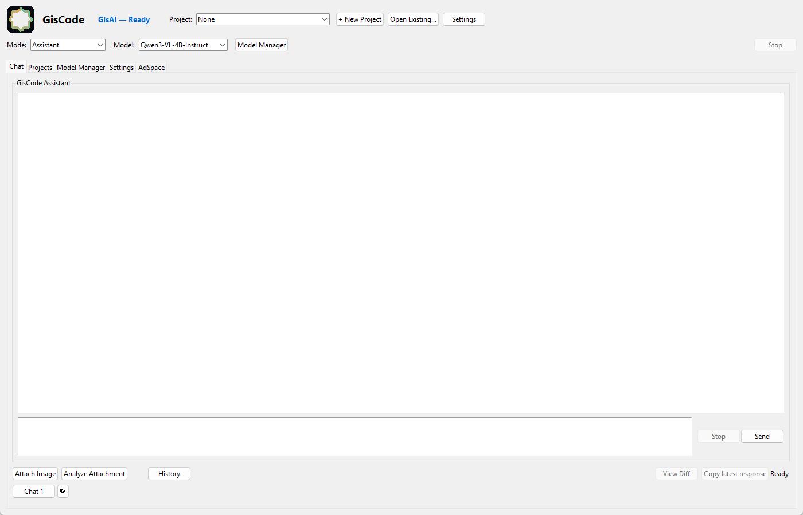

# GisCode

GisCode is a local-first coding agent with a Tk desktop GUI. You describe a
change in a project folder; it plans the work, edits files with your approval,
runs commands and tests, and verifies the result. By default everything runs on
your machine against a `llama-server` that you supply — no cloud service is
required, and no account is needed.

> **Status: early alpha.** This is a working research project, not a finished
> product. It is developed and tested on Windows only. There is no installer yet.
>
> **New here?** Install with [Installation](docs/INSTALLATION.md), learn the
> window with the [User guide](docs/USER_GUIDE.md), connect a model with
> [Local AI setup](docs/LOCAL_AI_SETUP.md), and check what fits your machine
> with [Model compatibility](docs/MODEL_COMPATIBILITY.md). For the one-page
> version use the [Quick start](docs/QUICKSTART.md); if startup fails, use
> [Troubleshooting](docs/TROUBLESHOOTING.md).



*GisCode Core on Windows. Every screenshot in these docs is taken from the real
application.*

## Editions

**GisCode Core** is the free edition in this repository, and what you get when
you run it: Chat, Projects, attachment analysis, the Model Manager, essential
settings and the GisCode AdSpace panel.

**GisCode Pro** adds the developer and release tools — Terminal, iOS / xtool,
GisLogo, Developer & Release, Device Preview, Generate Video, Project Doctor,
hosted-writer settings and the status/history tabs — and is ad-free. Its
implementation is **not** part of this public repository, which is the Core
edition; see [`docs/CORE_AND_PRO.md`](docs/CORE_AND_PRO.md).

The edition is a launch-time configuration, not a licence check: this build has
no activation system. `set GISCODE_EDITION=pro` here has no Pro tools to start,
so GisCode reports them as unavailable and runs the Core tools.

## What actually works

- End-to-end task execution on **small, well-scoped tasks**: plan -> approved
  file edit -> command/test run -> verification, with the outcome reported in
  the GUI and recorded in local history.
- Workspace confinement: actions are resolved inside the selected project
  folder, and paths that escape it are rejected.
- An approval step before edits and before destructive commands.
- A test baseline/verify/repair loop with a shared time budget, so verification
  passes cannot each start a fresh full timeout.
- Local inference through `llama-server` (llama.cpp), plus an optional hosted
  writer that is **disabled by default** (see `docs/HOSTED_WRITER.md`).
- Multiple local providers: Ollama, LM Studio's server, and OpenAI-compatible
  endpoints, with per-purpose model profiles, a connection test and a separate
  coding-capability test. See [`docs/LOCAL_AI_SETUP.md`](docs/LOCAL_AI_SETUP.md).
- Task outcomes are written to a local history and learning store.

## What does not work well, or at all

- **Reliability on larger tasks is not measured.** Small tasks have completed
  end to end with approval and verification; multi-file or long-running jobs
  frequently need manual steering.
- **Model quality is the main limit.** With small local models the agent often
  fails. An 8-job benchmark in October 2026 scored **0 of 8** with the small
  local models used at the time. A larger, stronger coder model is the single
  biggest improvement available to you.
- **The Core build has no free-form chat or image analysis.** Chat performs
  deterministic file operations and declines the rest with "GisCode Core cannot
  carry out that request without GisAI"; **Analyze Attachment** fails the same
  way. Both need the generative GisAI engine, which is not in this repository.
  Planning in Projects is the part that calls the local model. See
  [`docs/USER_GUIDE.md`](docs/USER_GUIDE.md#3-use-the-chat-tab).
- **Lessons are not yet used.** Outcomes are recorded, but recorded lessons are
  not injected into later prompts, so the agent does not measurably improve
  from its own history yet.
- **Project Doctor** (Pro) is a placeholder: it states that no Project Doctor
  service is connected in this build.
- **iOS build and signing** (Pro) is experimental and depends on external tools
  (xtool, macOS, Xcode). It is not supported on Windows alone.
- **GisCode AdSpace has no provider.** Unity Ads and AppLovin are mobile-only and
  cannot run in a Windows desktop build, so the panel reports that honestly and
  shows no advertising. See [`docs/ADVERTISING.md`](docs/ADVERTISING.md).
- Packaging is partial: a PyInstaller recipe exists (`GisCode.spec`), but no
  release build is provided or supported.

## Local-only operation, and models versus servers

GisCode Core runs on your machine and talks to a `llama-server` process that it
starts itself on loopback. There is no account, no telemetry, no analytics and no
working advertising provider in this build.

Two steps are easy to confuse:

| Step | What it means | Who does it |
| --- | --- | --- |
| **Installing a model** | Putting a `.gguf` file on disk — a download you perform | You |
| **Connecting it to GisCode** | GisCode discovering that file, starting its own `llama-server`, loading the file and answering a prompt | GisCode, using the server binary and model folder you supply |

Downloading a model does not connect it. The file must sit in a folder GisCode
scans (`~/.giscode/models`, `~/.lmstudio/models`,
`C:\Users\Public\lmstudio\models`, or the `paths.models_dir` setting) and a
`llama-server` binary must be available.

GisCode runs a GGUF file in its own `llama-server` **or** uses another local
server as a provider: **Ollama**, **LM Studio's local server**, or any
OpenAI-compatible endpoint you add by URL. Providers are loopback by default and
are selected in Model Manager, where each one reports whether it is actually
running. See [Local AI setup](docs/LOCAL_AI_SETUP.md).

The only things that leave your machine are the ones you initiate: installing
Python packages from PyPI, and downloading models, servers or code yourself.
Once those are on disk, GisCode works offline. The optional hosted writer is a
Pro feature, disabled by default, and absent from this repository.

## Requirements

- **Windows 10/11** (the code has some POSIX paths, but Windows is the tested
  platform).
- **Python 3.13 with tkinter.** On python.org installers tkinter is included by
  default; if `import tkinter` fails, re-run the installer and enable
  "tcl/tk and IDLE".
- **A llama.cpp `llama-server` binary** (MIT licensed, *not* bundled here).
  Either put `llama-server.exe` on `PATH`, or set
  `GISCODE_LLAMA_SERVER_PATH` to its full path.
- **A GGUF chat/coder model** that fits your RAM/VRAM. GisCode does not
  download models.
- Disk space for the model and for the local profile (history, logs,
  snapshots) in `~/.giscode`.

## Install and run from source

```bat
git clone https://github.com/Jusoor-LLC/GisCode-Core.git GisCode
cd GisCode
py -3.13 -m pip install -r requirements.txt
py -3.13 -m giscode.main
```

`py -3.13 -m giscode.main` boots the application and opens the main window.
A headless smoke check of the GUI code path (it builds the window, prints the
tab list and exits) is:

```bat
py -3.13 -m giscode.main --gui-check
```

It exits non-zero with `GUI_CHECK_FAIL: ...` if the window cannot be built.

For upgrade and manual-removal guidance, see
[Upgrade and removal](docs/QUICKSTART.md#upgrade-and-removal). There is no
uninstaller and no background service.

## Where GisCode looks for the server and the models

`llama-server` is resolved in this order (see `giscode/inference/runtime.py`):

1. The `GISCODE_LLAMA_SERVER_PATH` environment variable (line 36, used at
   line 174) — must point at an existing `.exe`.
2. `llama-server` on `PATH` (`shutil.which`, line 194).
3. The known locations listed at lines 30-34:
   `~/.lmstudio/extensions/backends`, `C:/Program Files/llama.cpp/bin`,
   `C:/llama.cpp/bin`.

Server readiness is polled until it answers `/health`; the timeout is
`GISCODE_LLAMA_READY_TIMEOUT` seconds (line 37, default 60).

Models are GGUF files discovered from (`giscode/models/manager.py:118-120`):

- `~/.giscode/models` (override with the `paths.models_dir` setting,
  `giscode/config/settings.py:20`)
- `~/.lmstudio/models`
- `C:/Users/Public/lmstudio/models`

Select a model in the GUI; GisCode loads it through its own `llama-server`
process and stops only the process it started.

## Settings

Settings live in `~/.giscode/config.json` and are editable from the GUI. Two
environment variables matter for local runs:

- `GISCODE_LLAMA_SERVER_PATH` — pin a specific server binary.
- `GISCODE_HOME` — redirect every profile write (config, history, logs,
  learning store) to another directory. Use this for tests and experiments; it
  is what the test suite does.
- `GISCODE_EDITION` — `pro` asks for the Pro tools (absent from this public
  tree); unset or any other value is Core.
- `GISCODE_TEST_MODE=1` — isolated test mode: discovery and autoload use only the
  configured (relocated) models folder and never the personal LM Studio folders.

## Running the tests

```bat
py -3.13 -m pip install pytest "PyYAML>=6" "Pillow>=10"
py -3.13 -m pytest tests --ignore=tests/fixtures
```

- `tests/` uses an isolated `GISCODE_HOME` automatically, so a test run does
  not write into your real profile.
- `--ignore=tests/fixtures` is required: that folder holds sample *projects*
  (with their own stub test files) that the inspector tests read as input, not
  tests of GisCode.
- No test loads a real model or needs a network connection. Tests that would
  need a real model are opt-in (`GISCODE_RUN_REAL_MODEL_TESTS=1`) and skip by
  default.
- The GUI tests need a usable Tk. Most of them skip when Tk cannot be
  created, but a few build the window directly and will fail with a
  `TclError` on a machine that has no Tk at all.

## Safety design

- Actions are resolved against the selected project root; the executor rejects
  paths outside it.
- Edits and destructive commands require approval; the approval facts are
  recorded with the task.
- Every command runs with a timeout and its output is capped.
- Server cleanup only targets processes this application started. A
  `llama-server` that was already running is reported and left alone.
- Task results distinguish success, failure, timeout, `could_not_run` and user
  cancellation, and a run that could not complete is never reported as a pass.

## Building a Windows EXE

`GisCode.spec` is the PyInstaller recipe used by the author
(`pyinstaller GisCode.spec`). The build is **not** verified in this repository
and is not required to run from source. The frozen build has no console, so
look in the log file under `~/.giscode/logs` when it misbehaves.

## Documentation

Start here:

- [`docs/INSTALLATION.md`](docs/INSTALLATION.md) — prerequisites, step-by-step
  install, first launch, verification and upgrade/removal.
- [`docs/USER_GUIDE.md`](docs/USER_GUIDE.md) — the Core interface: Chat,
  Projects, Model Manager, attachment analysis, model selection and common
  workflows.
- [`docs/LOCAL_AI_SETUP.md`](docs/LOCAL_AI_SETUP.md) — how GisCode runs models,
  model folders, `llama-server` discovery, and what is and is not supported
  (including Ollama and LM Studio).
- [`docs/MODEL_COMPATIBILITY.md`](docs/MODEL_COMPATIBILITY.md) — supported
  formats, quantization, VRAM/RAM guidance and model selection.

Reference:

- [`docs/QUICKSTART.md`](docs/QUICKSTART.md) — clean Windows install, first run,
  local model setup, upgrade and manual removal.
- [`docs/TROUBLESHOOTING.md`](docs/TROUBLESHOOTING.md) — startup, Tk, model,
  server, test and cleanup failures.
- [`docs/ARCHITECTURE.md`](docs/ARCHITECTURE.md) — components, control flow and
  non-negotiables.
- [`docs/CORE_AND_PRO.md`](docs/CORE_AND_PRO.md) — what each edition contains and
  how the separation is enforced.
- [`docs/ADVERTISING.md`](docs/ADVERTISING.md) — the AdSpace panel, the provider
  research and why provider integration is blocked.
- [`docs/HOSTED_WRITER.md`](docs/HOSTED_WRITER.md) — the optional hosted writer
  (Pro).
- [`docs/RELEASE_NOTES.md`](docs/RELEASE_NOTES.md) — what this snapshot contains,
  and what it does not.
- [`Universal_iOS_Deployment_Pattern.md`](Universal_iOS_Deployment_Pattern.md)
  — the Windows → WSL2 → xtool → iPhone pattern the iOS skill reads.
- [`CONTRIBUTING.md`](CONTRIBUTING.md) — how to run and add tests.
- [`SECURITY.md`](SECURITY.md) — how to report a vulnerability.
- [`NOTICE`](NOTICE) — copyright, attribution and third-party components.
- [`TRADEMARK.md`](TRADEMARK.md) — the names and logo, and the absence of any
  trademark or branding-rights grant.

## License

**Apache License, Version 2.0.** See [`LICENSE`](LICENSE) for the full text; it
is the standard, unmodified licence. Copyright 2026 Jusoor Company LLC.

You may use, modify and redistribute the code under that licence, including
commercially, provided you keep the licence and `NOTICE` files and mark files
you changed. The licence covers the code, not the brand: the GisCode name and
the Gis logo are not granted as trademark or branding rights, and no ownership
is asserted; a fork must not present itself as official GisCode (see
[`TRADEMARK.md`](TRADEMARK.md)).

This repository's licence statement is a project decision, not legal advice;
the owner still intends a qualified legal review before the first public push.
