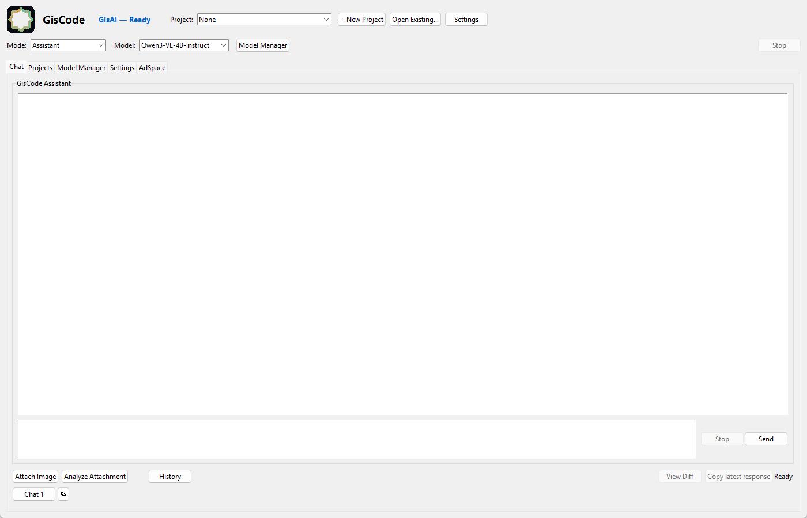
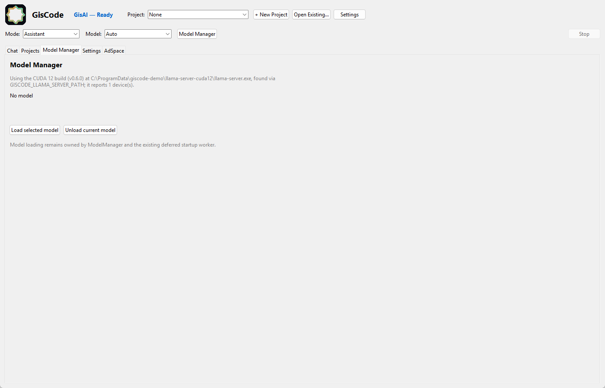

# Installing GisCode Core on Windows

This guide takes you from a fresh Windows machine to a working GisCode Core
window with a local model loaded. It is written for someone who has never run a
local AI model before.

GisCode Core is the free edition in this repository. A few things to know before
you start:

- It runs on your own computer. No account and no cloud service are required.
- It is **early alpha** software, and it is developed and tested on Windows only.
- There is no installer. You run it from source with Python.

If you want the short version, [`QUICKSTART.md`](QUICKSTART.md) is a one-page
summary of this guide. If something fails, use
[`TROUBLESHOOTING.md`](TROUBLESHOOTING.md).

---

## 1. What you need

| Item | Requirement | Why |
| --- | --- | --- |
| Operating system | Windows 10 or 11 (64-bit) | The tested platform. |
| Python | **3.13**, with tkinter | GisCode's package metadata requires Python 3.13 or newer; the GUI needs tkinter. |
| Disk space | Model size + ~1 GB for the app and its profile | Models are several gigabytes each. |
| `llama-server` | A llama.cpp build (**not** bundled) | GisCode launches this to run the model. |
| A model file | One **GGUF** chat or coding model | GisCode does not download models for you. |
| RAM or VRAM | Enough for the model you choose | See [`MODEL_COMPATIBILITY.md`](MODEL_COMPATIBILITY.md). |

You do **not** need Node.js, Docker, WSL, a database, or a GPU to install
GisCode. A GPU makes inference much faster, but a CPU-only machine can run small
models slowly.

---

## 2. Install Python 3.13

1. Download the Windows installer from <https://www.python.org/downloads/windows/>.
2. Run it and tick **"Add python.exe to PATH"** on the first screen.
3. On the optional-features screen, leave **"tcl/tk and IDLE"** enabled. This is
   what provides tkinter, the toolkit GisCode's window is built with. It is
   enabled by default; if you untick it, the app cannot start.
4. Finish the installer, then open a **new** Command Prompt or PowerShell window
   and check:

   ```bat
   py -3.13 --version
   ```

   Expected output (the patch number may differ):

   ```
   Python 3.13.x
   ```

5. Confirm tkinter works:

   ```bat
   py -3.13 -c "import tkinter; print('tk ok')"
   ```

   Expected output:

   ```
   tk ok
   ```

If step 5 prints an error instead, re-run the Python installer, choose
**Modify**, and enable "tcl/tk and IDLE".

> **Two Pythons on one machine.** `python` on `PATH` may be an older version.
> Always use `py -3.13` so you get the interpreter GisCode expects. Mixing them
> is the most common cause of "it installed but nothing runs".

---

## 3. Get the code and install the dependencies

```bat
git clone https://github.com/Jusoor-LLC/GisCode-Core.git GisCode
cd GisCode
py -3.13 -m pip install -r requirements.txt
```

If you do not have Git, download the repository ZIP from GitHub, extract it, and
run the `pip` command from inside the extracted folder instead.

Expected result: `pip` finishes with a line like
`Successfully installed ...`. A warning that a newer `pip` is available is
harmless.

Optional, but recommended if you intend to run the test suite (the test tools are
declared as an extra in `pyproject.toml`):

```bat
py -3.13 -m pip install -e ".[test]"
```

Both commands install into the same Python 3.13 environment, so you can run
either one first.

---

## 4. Get a `llama-server` binary

`llama-server` comes from [llama.cpp](https://github.com/ggml-org/llama.cpp)
(MIT licensed). GisCode is a client for it: it starts the server itself, so you
never start it by hand.

Pick whichever option is easiest for you:

**Option A — you already use LM Studio.** LM Studio ships llama.cpp backends.
GisCode looks in `~/.lmstudio/extensions/backends` automatically, so you may not
need to install anything. See
[`LOCAL_AI_SETUP.md`](LOCAL_AI_SETUP.md#4-lm-studio-provider)
for the details.

**Option B — install llama.cpp yourself.** Download a Windows release from the
llama.cpp releases page, extract it, and either:

- put `llama-server.exe` on your `PATH`, or
- keep it anywhere and set `GISCODE_LLAMA_SERVER_PATH` to the full path of the
  `.exe` before launching GisCode:

  ```bat
  set GISCODE_LLAMA_SERVER_PATH=C:\tools\llama.cpp\llama-server.exe
  ```

GisCode looks for the server in this order:

1. `GISCODE_LLAMA_SERVER_PATH`, if set and it points at an existing `.exe`.
2. `llama-server` on `PATH`.
3. `~/.lmstudio/extensions/backends`, `C:\Program Files\llama.cpp\bin`,
   `C:\llama.cpp\bin`.

Verify the binary you picked actually runs:

```bat
llama-server --version
```

Expected result: version information printed by the binary. An error here means
the path is wrong or the download is incomplete, and GisCode will not be able to
load a model either.

---

## 5. Get a GGUF model

GisCode loads **GGUF** files only. Get one from a model publisher (for example
the GGUF repositories on Hugging Face), or reuse models you already downloaded in
LM Studio.

GisCode discovers models in these folders:

- `~/.giscode/models` — create it if you want a GisCode-only library
- `~/.lmstudio/models`
- `C:\Users\Public\lmstudio\models`

You can also point GisCode at a different folder with the `paths.models_dir`
setting in `~/.giscode/config.json`.

Put the `.gguf` file in one of those folders and restart GisCode. A model in a
folder that GisCode does not scan will simply never appear in the model list —
this is the second most common setup problem after the missing server.

Which model should you pick? Start with something small; see
[`MODEL_COMPATIBILITY.md`](MODEL_COMPATIBILITY.md#6-choosing-a-model-that-fits).

---

## 6. First launch

From the repository folder:

```bat
py -3.13 -m giscode.main
```

What to expect:

1. A window titled **GisCode** opens with a header row (Mode and Model
   selectors, a **Model Manager** button and a **Stop** button) and tabs:
   **Projects**, **Chat**, **Settings**, **Model Manager** and **AdSpace**.
2. The window title reports model state, for example `No model loaded` or
   `Loaded: <model name>`.
3. If a model is available, GisCode loads it in the background. Loading can take
   from seconds to several minutes the first time.



*The Core interface with a local model selected in the header. The Model Manager
tab is where models are loaded and unloaded.*

You can use the app before a model finishes loading; chat replies just will not
work until a model is ready.

### Check the window without a display session

If you need to verify the install on a machine where you cannot look at the
screen, run the built-in smoke check:

```bat
py -3.13 -m giscode.main --gui-check
```

It builds the window, prints the tab list and exits. It exits non-zero with a
`GUI_CHECK_FAIL: ...` message if the window could not be built, which almost
always means tkinter is missing or broken.

---

## 7. Load a model and confirm it works

1. Open the **Model Manager** tab.
2. Read the status line. It reports the backend it found and any error.
3. In the header's **Model** dropdown, pick a model. `Auto` lets GisCode choose.
4. Click **Load selected model**.
5. Wait for the status to show the model as ready. The window title changes to
   `Loaded: <model name>`.
6. Check the newest file in `~/.giscode/logs`: it should contain
   `Model load succeeded` and a line naming the execution device. That confirms
   GisCode started its own server and loaded the model.

   You can also try a small request in **Projects → Planer**. Plan generation is
   slow in this alpha build and did not reliably return during testing, so treat
   the ready model plus the load log as the acceptance check.



*Model Manager: the resolved backend, the model status line, and the
Load/Unload controls.*

If the status stays on an error, or the load never finishes, work through
[`TROUBLESHOOTING.md`](TROUBLESHOOTING.md#the-window-opens-but-no-model-can-be-loaded) before
changing anything else.

---

## 8. Where GisCode keeps its files

Everything lives under your user profile:

| Path | Contents |
| --- | --- |
| `~/.giscode/config.json` | Settings, including `paths.models_dir`. |
| `~/.giscode/chats.db` | Chat and project conversations (SQLite). |
| `~/.giscode/logs` | Log files. Look here first when the app misbehaves. |
| `~/.giscode/models` | Optional GisCode-only model folder. |

`~` is your user folder, normally `C:\Users\<you>`.

To keep experiments separate from your real profile, set `GISCODE_HOME` to
another folder before launching:

```bat
set GISCODE_HOME=%TEMP%\giscode-demo
py -3.13 -m giscode.main
```

The test suite does the same thing, which is why running the tests never touches
your real history or settings.

---

## 9. Upgrading

There is no auto-updater and no background service.

1. Close GisCode.
2. In the repository folder, run `git pull`.
3. Re-run `py -3.13 -m pip install -r requirements.txt` in case dependencies
   changed.
4. Start the app again.

Your settings, chats and projects under `~/.giscode` are kept.

## 10. Removing GisCode

1. Remove the repository folder.
2. Optionally uninstall Python 3.13 if nothing else uses it.
3. Optionally delete `~/.giscode`. **This deletes your chats, projects and
   settings**, so back it up first if you may return.
4. Model files are yours; delete the `.gguf` files you added if you no longer
   need them.

---

## 11. If installation fails

| Symptom | Likely cause | What to do |
| --- | --- | --- |
| `py -3.13` is not recognized | Python 3.13 not installed, or the launcher is missing | Re-run the installer and tick "Add python.exe to PATH"; or use `python --version` to see what you do have. |
| `ModuleNotFoundError: No module named 'tkinter'` | tkinter was excluded during install | Modify the Python install and enable "tcl/tk and IDLE". |
| `pip` cannot reach the network | Proxy, firewall or TLS interception | Configure `pip`'s proxy settings, or use a network that allows PyPI. Do not disable your firewall to work around it. |
| `ERROR: No matching distribution found` | `pip` is running under an older Python | Use `py -3.13 -m pip ...`, not bare `pip`. |
| The window flashes and closes | A startup exception | Run from a Command Prompt so you see the traceback, then check the newest file in `~/.giscode/logs`. |
| Window opens, no models listed | Model folder not scanned | Move the `.gguf` into `~/.giscode/models` or `~/.lmstudio/models`, then restart. |
| Window opens, model never becomes ready | No usable `llama-server` | Check `llama-server --version`, then see [`LOCAL_AI_SETUP.md`](LOCAL_AI_SETUP.md). |

More detail, including test-suite and cleanup failures, is in
[`TROUBLESHOOTING.md`](TROUBLESHOOTING.md).

---

## Next steps

- [`USER_GUIDE.md`](USER_GUIDE.md) — how the interface works and common tasks.
- [`LOCAL_AI_SETUP.md`](LOCAL_AI_SETUP.md) — servers, model folders, and what is
  and is not supported.
- [`MODEL_COMPATIBILITY.md`](MODEL_COMPATIBILITY.md) — formats, memory, and
  choosing a model.
