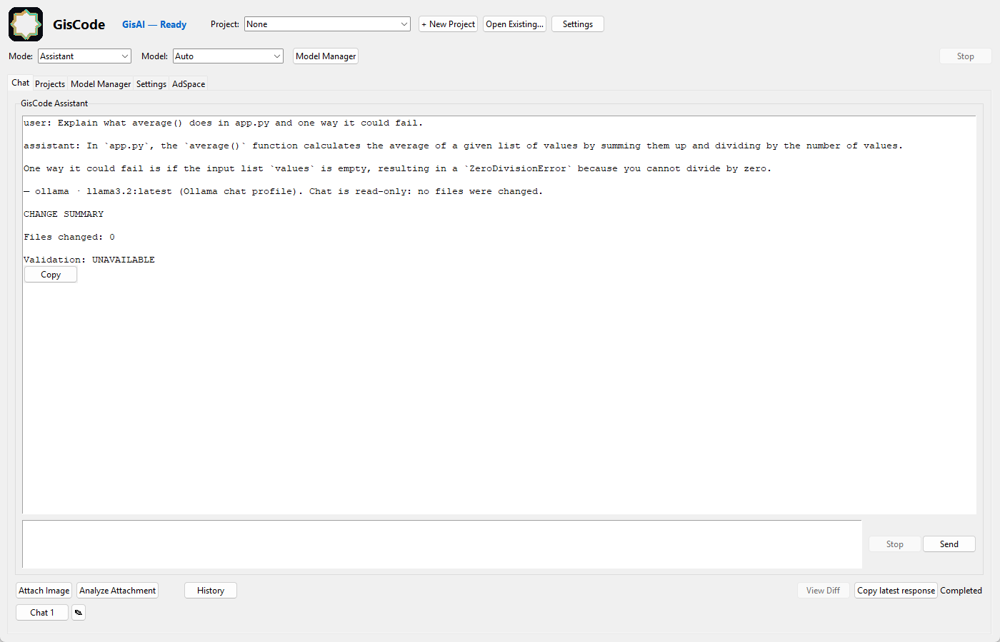
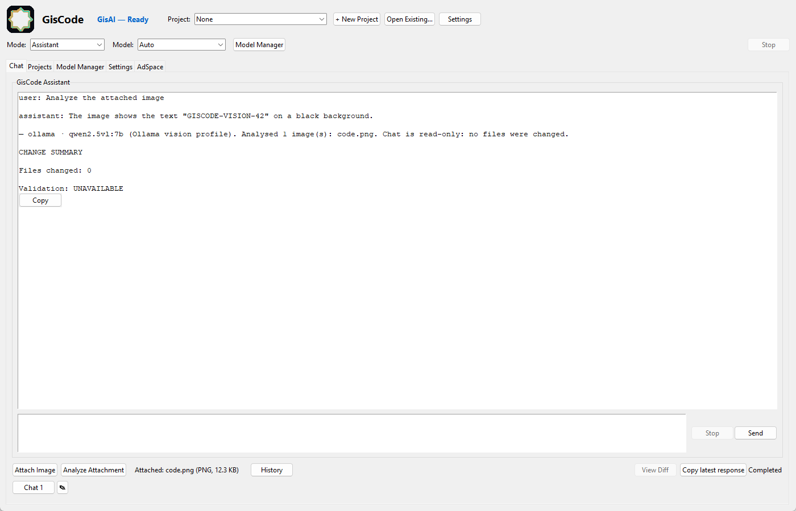

# Connecting a local AI model to GisCode Core

GisCode Core runs models on your own machine. There are two ways to do that, and
this guide covers both:

1. **GisCode's own runtime.** You give it a **GGUF** file and a `llama-server`
   binary; GisCode starts the server itself. This is the default.
2. **Another local server.** Ollama, LM Studio's local server, or any
   OpenAI-compatible endpoint, selected in **Model Manager → Local providers**.

Both are local. Neither needs an account, and neither sends your project
anywhere.

---

## 1. Which route should you use?

| You already have... | Use | Why |
| --- | --- | --- |
| A `.gguf` file | GisCode's own runtime | Full control over context and offload; GisCode reports exactly what it loaded. |
| Ollama installed with models pulled | Ollama provider | No second copy of the weights; Ollama owns loading and memory. |
| LM Studio installed with models downloaded | LM Studio provider, or LM Studio's files | The provider asks LM Studio's server; the file route loads the GGUF in GisCode's own server. |
| Another local server (llama.cpp, vLLM, ...) | OpenAI-compatible endpoint | If it serves `/v1/models`, GisCode can list and use it. |

You can have several at once. A **profile** records which provider and model you
want for coding, reasoning, chat or vision.

---

## 2. GisCode's own runtime (GGUF + `llama-server`)

### Where the model must be

GisCode discovers `.gguf` files in:

| Folder | Notes |
| --- | --- |
| `~/.giscode/models` | Create it for a GisCode-only library. Downloads from GisCode land here. |
| `~/.lmstudio/models` | Populated by LM Studio. |
| `C:\Users\Public\lmstudio\models` | LM Studio's shared folder. |

Or set `paths.models_dir` in `~/.giscode/config.json`. Restart after changing it.

Things that stop a model appearing:

- it is not `.gguf` (safetensors and `.bin` are ignored);
- it is still a `.part` download;
- it is in a folder GisCode does not scan;
- you added it while GisCode was running and did not restart.

Vision models also need the matching **`mmproj`** projector file in the same
folder.

### Where `llama-server` must be

GisCode looks for the server in this order:

1. `GISCODE_LLAMA_SERVER_PATH`, if it points at an existing `.exe`;
2. `llama-server` on `PATH`;
3. `~/.lmstudio/extensions/backends`, `C:\Program Files\llama.cpp\bin`,
   `C:\llama.cpp\bin`.

The backend note at the top of Model Manager names the one it resolved.

### Load it

1. **Model Manager** → choose a model in the header **Model** dropdown.
2. **Load selected model**.
3. Wait for `(Ready)` and the window title `Loaded: ...`.

Loading can take minutes the first time. A grey note about CPU-only loading
describes the machine, not a failure.

---

## 3. Ollama provider

GisCode talks to a running Ollama over its documented local API.

### Connect it

1. Install Ollama and make sure it is running (`ollama serve`, or the desktop
   app).
2. Pull a model, for example:

   ```bat
   ollama pull qwen2.5-coder:7b
   ```

3. In GisCode open **Model Manager → Local providers** and press **Refresh
   providers**. Ollama should show `OK ... reachable, N model(s)`.
4. In **Model profiles** choose Purpose `coding`, Provider `ollama`, pick the
   model, then **Save profile**.
5. Press **Test connection**, then **Test coding**.

Default endpoint: `http://127.0.0.1:11434`.

### What GisCode does and does not do with Ollama

- It lists the models Ollama already has, with quantization when Ollama reports
  it.
- It sends chat requests to Ollama and shows Ollama's answer.
- It does **not** download, pause, resume or delete Ollama models. `ollama pull`
  and `ollama rm` own that, and the UI says so rather than offering buttons that
  cannot work.

If Refresh reports `-- Ollama ... Nothing is listening on that endpoint`, the
server is not running or the port is different.

---

## 4. LM Studio provider

LM Studio can serve an OpenAI-compatible API from its own process, and it can
also just be the place you downloaded a GGUF file. These are different routes:

| Route | What happens | Use when |
| --- | --- | --- |
| **Provider** (`http://127.0.0.1:1234`) | LM Studio runs the model; GisCode sends requests to it | You want LM Studio to manage loading and memory |
| **Files** (`~/.lmstudio/models`) | GisCode's own `llama-server` loads the GGUF | You want GisCode's context/offload controls |

### Provider route

1. In LM Studio, load a model and start its local server.
2. In GisCode: **Model Manager → Local providers → Refresh providers**. LM Studio
   should report reachable with a model count.
3. Pick a profile provider/model and **Save profile**.

GisCode does not download or delete LM Studio's models.

### File route

GisCode scans `~/.lmstudio/models` and `C:\Users\Public\lmstudio\models`
automatically. Instead of loading the model in LM Studio, choose it in GisCode's
**Model** dropdown and press **Load selected model**. GisCode may also reuse LM
Studio's bundled `llama-server`; pin a specific build with
`GISCODE_LLAMA_SERVER_PATH` if updates move it.

---

## 5. Any other OpenAI-compatible endpoint

1. Start the server and note its base URL, for example
   `http://127.0.0.1:8080`.
2. **Model Manager → Local providers** → type a name and the URL → **Add
   endpoint**.
3. Press **Refresh providers** to confirm it answers and lists models.

Rules that apply:

- Only `http(s)` endpoints. Loopback is required unless you deliberately enable
  a remote endpoint for that provider.
- An API key, if the server needs one, is read from an **environment variable**
  named in the provider's configuration. Keys are never stored in
  `config.json` and never logged.
- GisCode does not assume vendor extensions: it uses `/v1/models` and
  `/v1/chat/completions` only.

---

## 6. Profiles, and what they do today

A profile binds a **purpose** to a provider and model:

| Purpose | Intended use |
| --- | --- |
| `coding` | Project work |
| `reasoning` | Planning and analysis |
| `chat` | General conversation |
| `vision` | Attachment analysis, when supported |

Actions in **Model profiles**: choose purpose/provider/model, **Save profile**,
and the profile becomes the active one for that purpose. GisCode remembers the
last profile that passed a test, so **a failed switch can be undone** rather than
guessed at.

**What the active profile actually drives:**

| Purpose | Where it is used |
| --- | --- |
| `chat` | The **Chat** tab: questions, code discussion, explanations |
| `coding` | **Projects**: planning and the edits you approve |
| `reasoning` | Recorded and testable; Projects currently plans with the `coding` model |
| `vision` | Attachments, only for a model the provider reports as vision-capable |

A purpose with no profile uses GisCode's built-in `llama.cpp` selection, exactly
as before. Switching the active profile takes effect on your **next** request -
no restart, no reinstall.

Two boundaries that do not move:

- **Chat is read-only.** The model may read a bounded view of the open project
  (a file list, plus the file you name), and it cannot create, edit, run or
  delete anything. A change is made in Projects, where you review a diff and
  approve it.
- **Connecting a model does not widen Core's permissions.** A request Core
  refuses by contract - running tests, deleting files, committing - stays
  refused even with a model selected.

When the selected provider or model cannot answer, GisCode names both and offers
the last selection that worked. It never silently switches provider, and never
falls back to a cloud model.

To make an Ollama model the one Projects uses, save a profile with purpose
**coding**; to make it answer Chat, save one with purpose **chat**.



*Chat answering through the active `chat` profile (Ollama, `llama3.2:latest`).
The reply is the model's own text, it ends with the provider and model that
produced it, and the change summary confirms nothing was written.*

### Attachments use the `vision` profile

An image is sent to the model in the **vision** profile. If that purpose has no
profile, a **chat** profile whose model is vision-capable is used and labelled as
such; otherwise the request is refused with a pointer to Model Manager. GisCode
never sends an image to a text-only model.



*`code.png` attached and read by `qwen2.5vl:7b`, which returned the code it saw.*

Ollama publishes a capability list per model (`completion`, `vision`, `tools`,
`thinking`), so the model picker reflects what the server says. LM Studio and
generic OpenAI-compatible endpoints publish nothing, so they stay text-only
unless you mark that provider vision-capable in its configuration. Images are
validated (format, readability, 16 MB limit) before anything is sent, and the
prompt treats anything written inside an image as untrusted data rather than
instructions.

---

## 7. Test that it works

Two tests, deliberately separate:

| Test | Question it answers | What a pass means |
| --- | --- | --- |
| **Test connection** | Is the provider running, is the model selectable, does a minimal request return? | The plumbing works. Nothing about quality. |
| **Test coding** | Does the model return a parseable `add(a, b)` plus a test? | The answer is structurally usable code. |

The coding test is static: the returned code is parsed with Python's `ast`, never
executed, and nothing is written to your project.

For GisCode's own runtime, the equivalent check is Model Manager reporting
`(Ready)` plus a log line:

```bat
type "%USERPROFILE%\.giscode\logs\giscode.log"
```

Look for `Model load succeeded` and the execution device (GPU or CPU).

**What a successful plan depends on:** the model, not the wiring. A 3B model
driving the Planner produced a valid single-step plan in under a second in
testing, while a larger model takes longer and a weak one may return nothing
usable. When the reply cannot be parsed, GisCode reports that and leaves the plan
untouched - it does not invent steps to look successful.

---

## 8. Endpoints, ports and firewalls

- Provider endpoints are loopback (`127.0.0.1`) by default, and GisCode's own
  `llama-server` listens on loopback on a port it chooses.
- No firewall rule is required, and you should not add an inbound exception. If a
  security product blocks a provider, allow that specific program.
- Readiness timeout for GisCode's server: `GISCODE_LLAMA_READY_TIMEOUT` seconds
  (default 60).
- Remote endpoints are opt-in per provider. GisCode does not send project files
  to a provider: a connection test sends only a one-word prompt, and the coding
  test sends one small, self-contained request.

---

## 9. Does it need the internet?

| Activity | Internet needed? |
| --- | --- |
| Installing GisCode's Python dependencies | Yes, once |
| Downloading a model or llama.cpp build | Yes, once, from wherever you get them |
| `ollama pull` / LM Studio model download | Yes, once, managed by those tools |
| Running GisCode with a local model or provider | **No** |
| Connection and coding tests | **No** |

---

## 10. Downloads inside GisCode

GisCode can download a **GGUF by direct URL** into its models folder, with
progress, pause, resume, cancel and retry. Pause/resume is real: it reconnects
with an HTTP `Range` request, and if a server ignores `Range` the partial file is
discarded and the download restarts rather than being stitched together.

Limits, stated rather than hidden:

- Only direct `http(s)` URLs. There is no built-in catalog and no invented
  metadata.
- Sources that require a login or a special client are not supported.
- Deleting a downloaded model always asks for confirmation, and refuses while
  that model is loaded.

---

## 11. Related reading

- [`INSTALLATION.md`](INSTALLATION.md) — Python, the server and the first launch.
- [`MODEL_COMPATIBILITY.md`](MODEL_COMPATIBILITY.md) — formats, quantization and
  memory.
- [`USER_GUIDE.md`](USER_GUIDE.md) — the interface.
- [`TROUBLESHOOTING.md`](TROUBLESHOOTING.md) — when a provider or model refuses.
