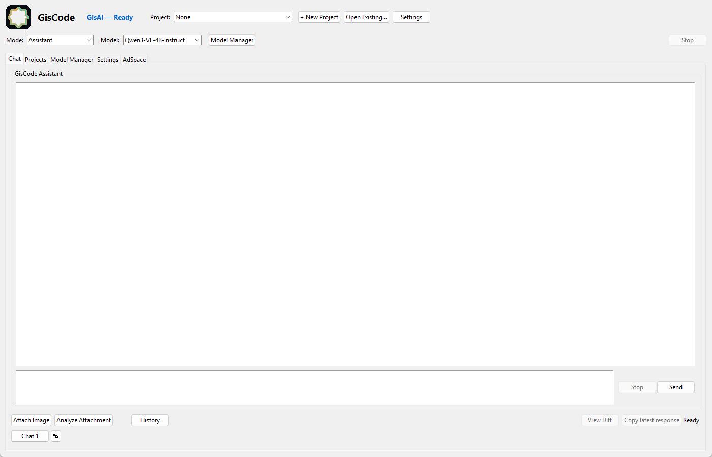
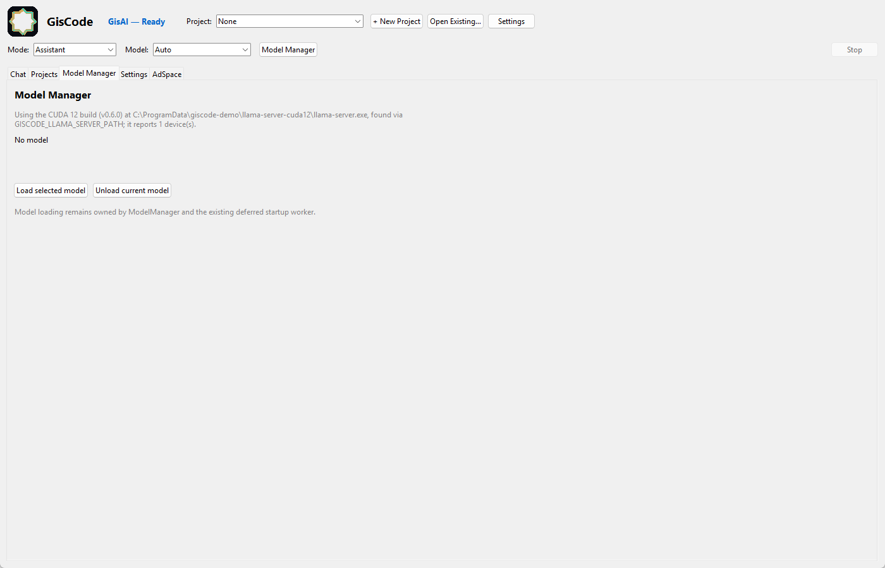
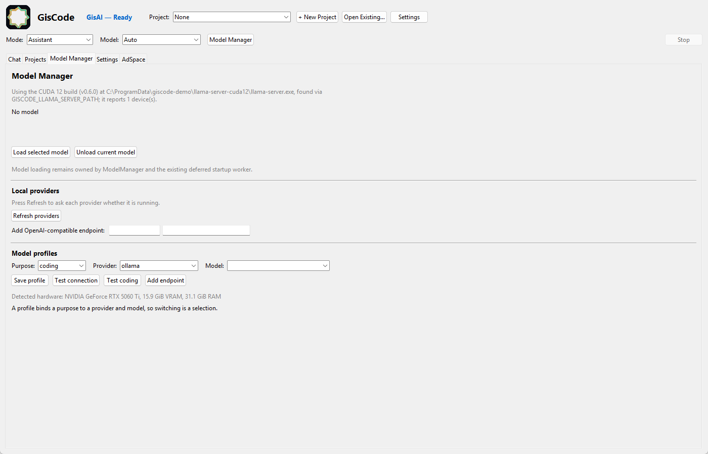
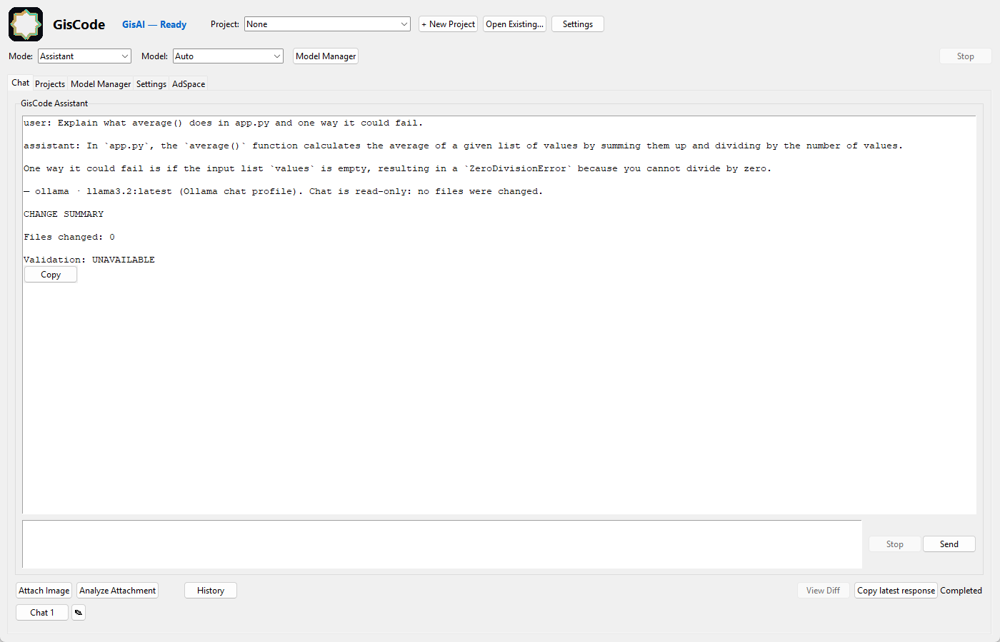
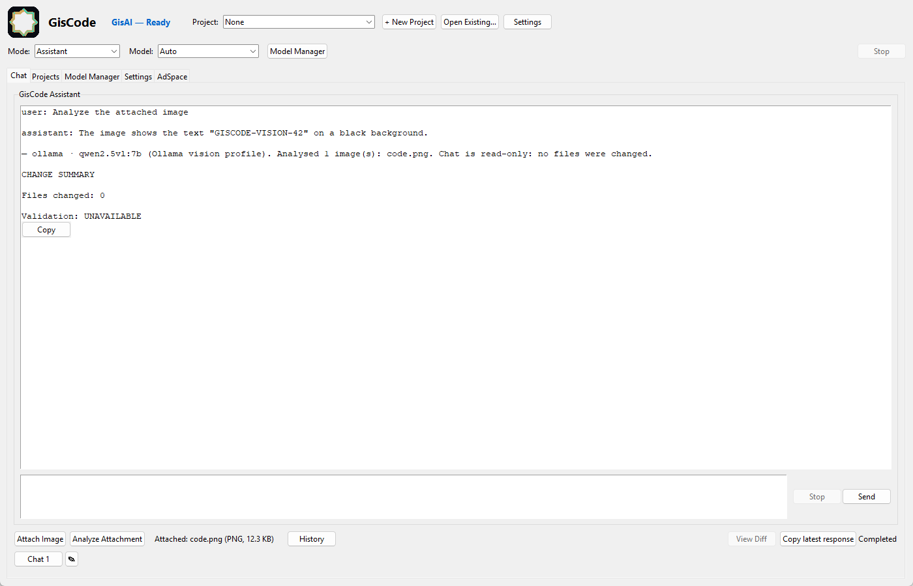

# GisCode Core user guide

This guide explains what you see when GisCode Core starts, and walks through the
tasks most people do first: asking a question, choosing a model, running a task
in a project, analysing an image, and finding an earlier conversation.

It describes **GisCode Core v0.1.0** as shipped in this repository. GisCode is
early alpha: some things are unfinished, and the guide says so where that
matters.

---

## 1. What GisCode Core is

GisCode is a local-first coding assistant with a desktop window. You describe a
change in a project folder; GisCode plans it with your local model, edits files
with your approval, runs commands and tests, and reports the result.

Planning is the part that genuinely runs on your local model today. The
generative execution engine (GisAI) is not part of this public repository, so
expect the deterministic Core operations described below rather than an
autonomous agent.

Everything runs on your machine. No account is needed, and no cloud service is
used.

The Core edition includes: **Chat**, **Projects**, **attachment analysis**, the
**Model Manager**, essential **Settings**, and the **AdSpace** panel. The
developer and release tools (Terminal, iOS/xtool, GisLogo, Developer & Release,
Device Preview, Generate Video, Project Doctor, hosted-writer settings) belong to
the separate GisCode Pro edition and are **not** present here. See
[`CORE_AND_PRO.md`](CORE_AND_PRO.md).

---

## 2. The window at a glance



*The main window: header controls at the top, then the tab strip, then the active
tab's content.*

### Header row

| Control | What it does |
| --- | --- |
| **Mode** | `Assistant`, `Planner`, `Coder` or `Reviewer` — the role the model is asked to take for the task. |
| **Model** | `Auto` plus every model GisCode discovered. Picking one pins it; `Auto` lets GisCode choose. |
| **Model Manager** | Jumps to the Model Manager tab. |
| **Stop** | Cancels the task currently running. It is disabled when nothing is running. |

### Tabs

| Tab | Purpose |
| --- | --- |
| **Projects** | Open a project folder, plan work, and run approved changes. |
| **Chat** | Ask questions and get replies; attach and analyse images; open conversation history. |
| **Settings** | Model summary and a shortcut to the Model Manager. |
| **Model Manager** | Load, unload and inspect models and the backend in use. |
| **AdSpace** | The advertising panel. It has no provider in this build and says so; it shows no ads. See [`ADVERTISING.md`](ADVERTISING.md). |

The window title is a status indicator, not decoration: it shows
`No model loaded`, `Loading...`, `Loaded: <model> <context>`, or an error such as
`No model - <reason>`.

### Before your first task

1. A model is loaded (title shows `Loaded: ...`). If not, see
   [`LOCAL_AI_SETUP.md`](LOCAL_AI_SETUP.md).
2. You have a project folder you are willing to let GisCode propose changes in.
   Start with a copy, or a folder under version control.

---

## 3. Use the Chat tab

**Important, and often surprising:** in this public build the Chat tab is a
*request channel*, not a free-form chatbot. GisCode Core carries out the requests
it can perform deterministically and **declines the rest** instead of
improvising with the model.

What Core can carry out: `create_file` (create a file), `read_file` (read a
file), `list_files` (list files), `search_text` (search text), `replace_text`
(replace text in one file).

1. Open the **Chat** tab.
2. Type the request in the input box at the bottom of the **GisCode Assistant**
   panel.
3. Press **Enter** (or **Ctrl+Enter**), or click **Send**.
4. The result appears in the panel above, with a **CHANGE SUMMARY** showing how
   many files changed and whether validation ran. **Stop** cancels a request in
   progress.

A general question such as *"What is a GGUF file?"* is answered like this:

```
GisCode Core cannot carry out that request without GisAI.
Supported here: create_file (create a file), read_file (read a file), ...
Request status: unsupported (unknown).
Reason: no supported Core capability matches this request.

No deterministic Core operation performs it, and Core does not improvise.
Nothing was changed.
```

That is the designed behaviour of the Core edition, not a model or install
problem. Free-form conversation and generative work belong to the GisAI engine,
whose code is not part of this public repository. If you loaded a model and still
see this message, the model is fine — the feature is simply not in Core.

Other notes:

- While a request runs, **Send** is unavailable and **Stop** is enabled.
- **Copy latest response** copies the most recent result to the clipboard.
- **History** (Core only) opens the conversation list inside the Chat tab —
  see [section 8](#8-reuse-an-earlier-conversation).
- Chat does not edit files on its own initiative; it performs the supported
  operations you ask for and reports exactly what changed.

### Choosing the right mode

| Mode | Use it for |
| --- | --- |
| **Assistant** | General questions and explanations. The default. |
| **Planner** | Turning a goal into a step-by-step plan. |
| **Coder** | Producing or reviewing code. |
| **Reviewer** | Critiquing a change or a plan. |

The mode changes how the model is asked to behave; it does not change which
model is loaded.

---

## 4. Work in a project

Projects are where GisCode actually changes files. The design is deliberately
cautious: edits and destructive commands need your approval.

1. Open the **Projects** tab.
2. Click **Open project** and choose the folder you want to work in.
3. Describe the goal in the project's prompt area — one well-scoped change at a
   time works far better than a large request.
4. Review the plan the Planner produces. It is a proposal, not an action.
5. Use **Approve & Start** to hand the approved plan to the build loop.
6. Approve individual file edits as they are proposed. Read the diff before
   approving; **View Diff** shows it.
7. Let GisCode run the project's tests and report verification.
8. Read the outcome. Success, failure, timeout, and "could not run" are reported
   as different results — a run that could not complete is never shown as a pass.

The Planer sub-tab is the part of Core that sends your request to the local
model. Its box is labelled **Plan request (planning only)**: it authors a plan,
and does not edit files. **Save Plan**, **Get Readiness** and **Approve & Start**
operate on the plan the model produced.

**Known limitation (v0.1.0):** planning is slow with small local models, and
while testing for this documentation a plan request could sit without producing
an answer. If **Plan** leaves the reply line empty, treat that as a limitation of
this alpha build rather than a broken install, and check the newest file in
`~/.giscode/logs`.

**Close project** releases the folder without deleting anything.

### What confinement means

Every action is resolved inside the selected project folder. Paths that would
escape it are rejected, and commands run with a timeout. This protects the rest
of your disk; it does not make a bad edit impossible, which is why approval
matters.

### Practical advice

- Start with a task you could finish yourself in ten minutes.
- Keep the project under version control so you can revert.
- If a plan is wrong, correct it before approving rather than approving and
  fixing afterwards.
- Small local models fail at multi-file work more often than at single-file work.
  See [`MODEL_COMPATIBILITY.md`](MODEL_COMPATIBILITY.md).

---

## 5. Choose, load and switch models

1. Open **Model Manager**.
2. Read the backend note: it reports which `llama-server` GisCode found.
3. In the header **Model** dropdown, pick a model, or keep `Auto`. The dropdown
   lists `Auto` plus every model GisCode discovered.
4. Click **Load selected model**. The status line reports progress and then
   readiness; the title bar switches to `Loaded: ...`.
5. To free memory, click **Unload current model**, then load another.



*Model Manager: the backend GisCode resolved, the model status line, and the
load/unload controls. A grey note about CPU-only loading is information about
the machine, not a failure.*

- **Red text** is an error: the load failed, or the server could not start.
- **Grey text** is a fact about the machine, such as running without GPU offload.
- Loading can take minutes for a large model the first time.
- Only one model is loaded at a time. Switching models unloads the previous one.

### Other local servers

Below the load controls, Model Manager lists local **providers**:



*Providers and profiles in Model Manager, plus the detected hardware line.*

- **Local providers** — press **Refresh providers**. Each one reports `OK` with a
  model count, or `--` with the reason it could not be reached. "Configured" is
  never shown as "running".
- **Add OpenAI-compatible endpoint** — a name and a URL. Loopback only unless you
  enable a remote endpoint for that provider.
- **Model profiles** — choose a **Purpose** (coding, reasoning, chat, vision), a
  **Provider**, and a **Model**, then **Save profile**. The profile becomes active
  for that purpose.
- **Test connection** asks whether the provider answers at all.
- **Test coding** asks whether the model returns usable code. It parses the answer
  and never executes it.
- A hardware line reports RAM and VRAM as detected.

A profile is not just a label: the active **chat** profile answers the Chat tab,
and the active **coding** profile plans the work in Projects. Switching takes
effect on your next request — no restart. A purpose with no profile uses the
built-in `llama.cpp` selection as before.

What stays the same when a provider model is answering:

- Chat is **read-only**. It can read a bounded view of the open project (a file
  list, plus the file you name) and cannot write, run or delete anything.
- Edits still happen in Projects, behind the approval diff. A rejected diff
  changes nothing.
- Requests Core refuses by contract — running tests, deleting files, committing —
  stay refused even with a model selected.
- If the provider is down or the model is missing, GisCode says which provider
  and model failed and points at the last profile that worked. It does not switch
  provider on its own.

Every Chat answer ends with the provider and model that produced it, so you can
tell which model you are talking to without opening Model Manager.



*The selected profile answering a question about the open project. Chat reports
`Files changed: 0` because it cannot write: edits belong to Projects.*

Model files must be GGUF and in a folder GisCode scans; see
[`LOCAL_AI_SETUP.md`](LOCAL_AI_SETUP.md#2-giscodes-own-runtime-gguf--llama-server).

---

### Streaming answers and Stop

Ollama, LM Studio and OpenAI-compatible servers send an answer as it is
generated, so Chat shows the text as it arrives. The built-in `llama.cpp`
runtime streams the same way. A provider that cannot stream still answers in one
piece; Chat never shows a fake partial answer.

**Stop** closes the connection GisCode opened and keeps the text you already saw,
clearly labelled as a partial answer. A stopped reply is never presented as a
finished one.

Starting a new chat while an answer is streaming stops that answer in its
original conversation. Its partial text is kept there and is never copied into
the new chat.

One limit is worth knowing: Stop ends *this computer's* side of the request.
Ollama, LM Studio and any remote server may keep computing until they notice the
client has gone; GisCode cannot force another program to stop. Only what this
computer was doing is guaranteed to stop.

## 6. Attach an image

The attachment row under the conversation has **Attach Image** and **Analyze
Attachment**.

1. Click **Attach Image** and choose a picture. The label confirms what is
   attached, for example `Attached: diagram.png (PNG, 4.3 KB)`.
2. The attachment is recorded with the conversation turn.
3. **Analyze Attachment** asks the application to read the image.

**Analyze Attachment sends the image to your selected vision model.** To set
that up once:

1. Open **Model Manager** and refresh **Local providers**.
2. Under **Model profiles**, choose **Purpose = vision**, a **Provider**
   (`ollama`), and a model the provider reports as vision-capable
   (`qwen2.5vl:7b`), then **Save profile**. The dropdown lists only models the
   provider itself declares capable; GisCode does not guess from a model name.
3. Attach an image and click **Analyze Attachment**.



*A real run: `code.png` was attached and `qwen2.5vl:7b` read the code inside it.
The footer names the provider and model and repeats that nothing was written.*

- Supported formats are PNG, JPEG, WebP, BMP and GIF; images up to 16 MB.
  Anything else is rejected **before** a request is made, with the reason shown.
- A text-only model never receives the image. GisCode says the selection cannot
  read images and points you at the vision profile instead of quietly answering
  from text.
- Attached text inside an image is treated as untrusted content by the prompt:
  it cannot grant permissions or change GisCode's rules.
- If no vision profile exists but your **chat** profile's model is
  vision-capable, that model answers and the footer says so.
- Other attachment types (PDF and similar) are not analysed by Core; the request
  fails and states that nothing was sent.

Privacy note: analysis runs on the provider you configured. A loopback provider
means nothing leaves the machine; remote endpoints are opt-in per provider and
the endpoint is shown in the footer.

**Remote endpoints need a second, separate yes before an image is sent.** In
Model Manager, *Allow images to be sent to remote (non-loopback) providers* is
off by default. While it is off, a remote endpoint can answer text but an
attached image is refused **before transmission**, with the endpoint named and
the line `Nothing left this computer.` Turning it on is a setting you change
deliberately; adding an endpoint or selecting a model never grants it, and
switching to a remote provider re-checks it on the next request.

---

## 7. Settings

The **Settings** tab is deliberately small in Core:

- A **Model** section showing the current model status and an **Open Model
  Manager** button.
- A **ChatGPT plan (Sign in with ChatGPT)** section. **Continue with ChatGPT**
  opens your system browser; the app shows the connected account, workspace
  when OpenAI reports it, whether plan usage was granted, which billing
  applies, and a **Disconnect** action. See [`CHATGPT_PLAN.md`](CHATGPT_PLAN.md).
- An **OpenAI API (optional, billable)** section. It is off by default. It shows
  the key status without ever showing the key, carries the billing disclosure,
  and refuses to send anything until you tick **Allow billable OpenAI API
  calls**. See [`OPENAI_DIRECT.md`](OPENAI_DIRECT.md).
- An **Advanced settings** section that states plainly that hosted-writer and
  self-improvement settings are Pro features. Apart from the opt-in OpenAI
  provider, Core runs entirely on your machine.

Settings are stored in `~/.giscode/config.json`. Editing that file by hand works,
but close GisCode first so changes are not overwritten.

Useful environment variables (set them before launching):

| Variable | Effect |
| --- | --- |
| `GISCODE_HOME` | Redirects all profile writes (config, chats, logs) elsewhere. |
| `GISCODE_LLAMA_SERVER_PATH` | Pins a specific `llama-server.exe`. |
| `GISCODE_LLAMA_READY_TIMEOUT` | Seconds to wait for the server's `/health` (default 60). |
| `GISCODE_EDITION` | `pro` requests Pro tools (absent from this repository); anything else is Core. |

---

## 8. Reuse an earlier conversation

1. Open **Chat** and click **History**.
2. The **Conversation History** panel lists saved conversations; selecting one
   shows its detail on the right.
3. Use **Open Conversation** to continue it, **Rename** to label it, **Delete**
   to remove it, and **New Chat** to start fresh.

Conversations are stored in `~/.giscode/chats.db`. They are part of your local
profile; back up `~/.giscode` if they matter to you.

Long conversations also consume the model's context window. If replies degrade
in a long session, start a new chat — that is usually the cause, not a broken
model.

---

## 9. What Core does not do

Knowing the limits saves time:

- **No free-form conversation.** Chat carries out deterministic file
  operations; general questions get the "cannot carry out that request without
  GisAI" refusal. See [section 3](#3-use-the-chat-tab).
- **No working image analysis.** Attaching an image works; analysing it fails
  with `Task failed`. See [section 6](#6-attach-an-image).
- **No file edits from Chat.** Only Projects changes files, and only with
  approval.
- **No model downloads.** You supply GGUF files.
- **No Ollama, and no connection to LM Studio's API.** See
  [`LOCAL_AI_SETUP.md`](LOCAL_AI_SETUP.md).
- **No background service and no auto-update.** The packaged build is installed
  and removed per user by `GisCodeSetup.exe`; a source checkout is removed by
  deleting its folder.
- **No unrequested paid calls.** The OpenAI provider is disabled until you
  enable billable calls; nothing is charged automatically. ChatGPT plan usage
  never falls back to API billing.
- **No browser credential harvesting.** Sign in with ChatGPT uses the official
  OAuth flow in your system browser; GisCode never reads cookies, passwords or
  MFA codes.
- **No telemetry or analytics.** Nothing reports usage anywhere.
- **No working ad provider.** The AdSpace panel says so and shows nothing.
- **Pro tools are absent**, not hidden behind a paywall in this build.

---

## 10. When something goes wrong

Start with [`TROUBLESHOOTING.md`](TROUBLESHOOTING.md), which covers startup
failures, model and server problems, memory pressure, and first-launch issues. If
you are reporting a bug, include the newest log file from `~/.giscode/logs` and
the exact text shown in Model Manager.

---

## 11. Related documentation

- [`INSTALLATION.md`](INSTALLATION.md) — install and first launch.
- [`LOCAL_AI_SETUP.md`](LOCAL_AI_SETUP.md) — servers, model folders, providers.
- [`OPENAI_DIRECT.md`](OPENAI_DIRECT.md) — the optional direct OpenAI API route.
- [`CHATGPT_PLAN.md`](CHATGPT_PLAN.md) — the optional ChatGPT plan route.
- [`MODEL_COMPATIBILITY.md`](MODEL_COMPATIBILITY.md) — formats, memory, model
  choice.
- [`QUICKSTART.md`](QUICKSTART.md) — one-page install.
- [`ARCHITECTURE.md`](ARCHITECTURE.md) — how the pieces fit together.
